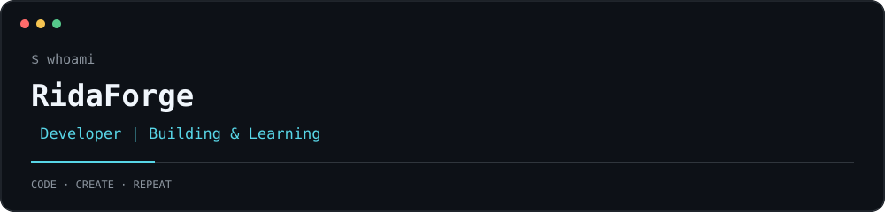
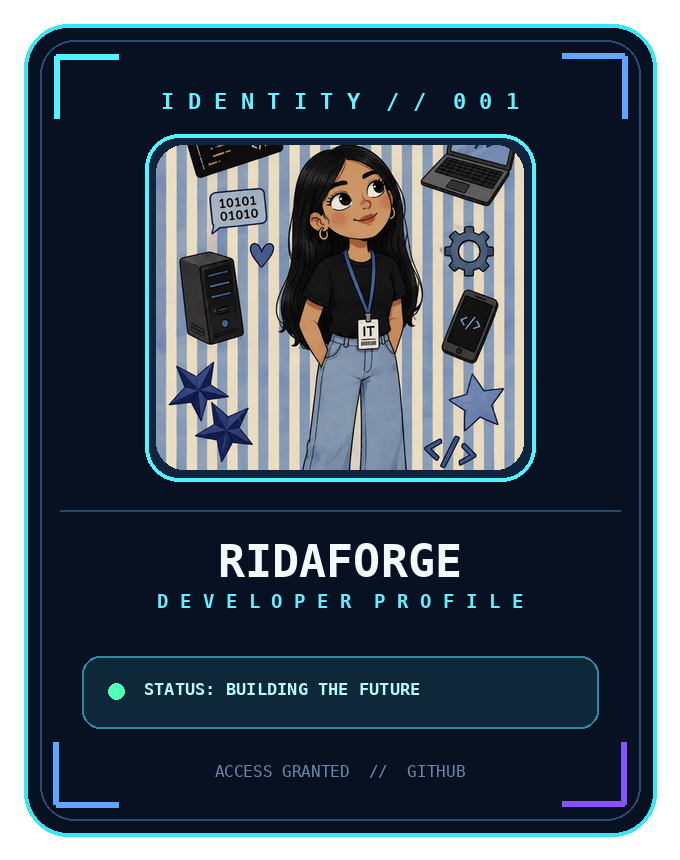

# Hi there 👋

  

  

<!-- ✨ About Me -->
<h2 align="center">✨ About Me</h2>

  Hey there! 👋 I'm <strong>RidaForge</strong>, a developer who loves
  turning creative ideas into digital experiences.

  💻 Exploring web development and modern technologies 
  ⚛️ Building with React, JavaScript and TypeScript 
  🎨 Interested in UI design and creative interfaces 
  🌱 Always learning, experimenting and growing 
  🚀 My goal is to build useful things with clean, creative code

  <i>“Turning ideas into code, one project at a time.” ✨</i>

<!-- 💻 Tech Stack -->
<h2 align="center">💻 Tech Stack</h2>

  
  
  
  
  
  
  
  
  
  
  
  
  
  
  
  

<h2 align="center">⚡ GitHub Stats</h2>

  
  

  

<!-- 🌐 Connect With Me -->
<h2 align="center">🌐 Connect With Me</h2>

  
  
  
  

<h2 align="center">📈 Contribution Activity</h2>

  

  <i>Every contribution is a step forward. 💻✨</i>

<h2 align="center">🐍 Contribution Snake</h2>

  <picture>
    <source media="(prefers-color-scheme: dark)" srcset="https://raw.githubusercontent.com/RidaForge/RidaForge/output/github-snake-dark.svg" />
    <source media="(prefers-color-scheme: light)" srcset="https://raw.githubusercontent.com/RidaForge/RidaForge/output/github-snake.svg" />
    
  </picture>

